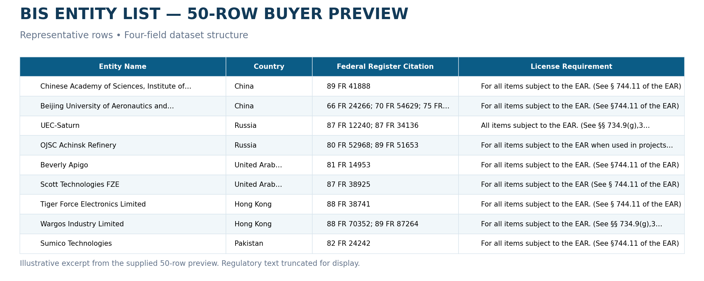
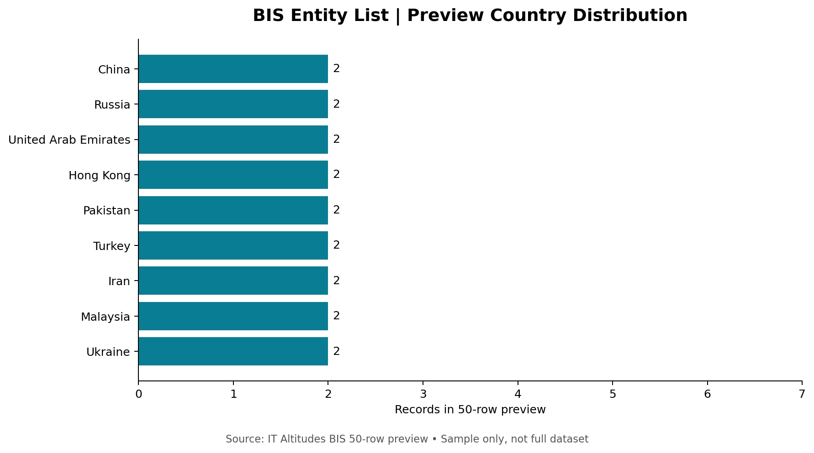

# BIS Entity List Dataset — Free 50-Row Buyer Preview

### U.S. Export Control & Trade Compliance Reference Data | IT Altitudes Inc.

**Free Preview Available in Excel, CSV & JSON**

🛒 **[Purchase the Complete BIS Entity List Dataset on Gumroad](https://italtitudes.gumroad.com/l/cuwozq)**

---

## About the Dataset

The **BIS Entity List Reference Dataset**, prepared by **IT Altitudes Inc.**, provides structured reference information derived from publicly available U.S. Bureau of Industry and Security (BIS) Entity List materials.

Designed for trade compliance research, export-control analysis, regulatory intelligence, and data engineering, this dataset helps users explore organized entity records without manually assembling reference information from multiple source materials.

The repository contains a **free 50-row buyer preview** so users can evaluate the data structure before purchasing the complete dataset.

## 📊 Dataset Overview

| Feature | Details |
|---|---|
| Dataset | BIS Entity List Reference Dataset |
| Publisher | IT Altitudes Inc. |
| Geographic Scope | International entities referenced in U.S. export-control materials |
| Primary Source | U.S. Department of Commerce — Bureau of Industry and Security |
| Free Preview | 50 selected records |
| Preview Columns | 4 |
| Preview Formats | Excel (.xlsx), CSV (.csv), JSON (.json) |
| Data Type | Static regulatory reference snapshot |
| Intended Use | Research, analytics, testing, and regulatory intelligence |

## 📂 Download the Free 50-Row Preview

Explore the dataset in your preferred format.

| Format | Recommended For | Download |
|---|---|---|
| Excel (.xlsx) | Spreadsheet review and analysis | [View Excel Preview](https://github.com/ITAltitudesDataset/bis-entity-list-dataset-preview) |
| CSV (.csv) | Python, R, SQL, and data analytics | [Download CSV Preview](BIS_Entity_List_50_Row_Preview.csv) |
| JSON (.json) | Developers, application testing, and data integration | [Download JSON Preview](BIS_Entity_List_50_Row_Preview.json) |

The Excel preview is available in the repository alongside the CSV and JSON files.

### Preview Fields

The 50-row preview includes:

| Column | Description |
|---|---|
| Entity Name | Entity name as represented in the curated source reference |
| Country | Associated country or jurisdiction |
| Federal Register Citation | Regulatory publication reference |
| License Requirement | Source-reported export licensing requirement information |

### Why Three Formats?

- **Excel:** Convenient for spreadsheet-based review and exploration.
- **CSV:** Suitable for analytics, database imports, and ETL workflows.
- **JSON:** Useful for structured data processing, software testing, and application integration.

The preview formats provide alternative ways to explore the selected sample records.

**Note:** The free preview contains only 50 selected records and does not represent the full scope of the BIS Entity List.

---

## ✨ Why Choose the Complete Dataset?

The value of the IT Altitudes buyer kit comes from its structured preparation, organization, and supporting documentation.

**Key benefits:**

- **Save research time:** Explore organized entity reference information.
- **Simplify data preparation:** Work with structured fields instead of manually reformatting source materials.
- **Support regulatory research:** Study entity listings, jurisdictions, and reported license requirements.
- **Improve analytical workflows:** Use reference records for research, comparison, and data modeling.
- **Enable software testing:** Evaluate data schemas and prototype non-production analytical systems.
- **Understand the data:** Use accompanying documentation to interpret fields, sources, and limitations.

## 🎯 Who Can Benefit?

| Audience | Potential Use |
|---|---|
| Trade compliance researchers | Export-control reference research |
| Risk and compliance analysts | Regulatory intelligence and historical analysis |
| Import/export researchers | Entity and jurisdiction reference studies |
| Data engineers | ETL development and schema testing |
| Software developers | Non-production application prototyping |
| Academic researchers | International trade and regulatory studies |
| Business intelligence teams | Structured reference-data analysis |

## 💼 Business Use Cases

The BIS Entity List Reference Dataset supports research, historical regulatory analysis, data engineering, and business intelligence applications involving U.S. export-control reference information.

The following use cases demonstrate how organizations can work with structured BIS Entity List records for analytical and non-production purposes.

### 1. Export-Control Regulatory Research

**Ideal for:** Trade compliance researchers, export-control analysts, and regulatory consultants.

**Business Application:**

- Examine entity names and associated jurisdictions represented in the reference dataset.
- Research source-reported export licensing requirements.
- Organize regulatory references for internal research and educational analysis.
- Study Federal Register citations associated with selected Entity List records.

**Potential Buyer Value:** Reduce manual organization of regulatory reference information and support more structured export-control research.

### 2. International Trade & Regulatory Intelligence

**Ideal for:** International trade researchers, policy analysts, and market intelligence teams.

**Business Application:**

- Analyze the geographic distribution of entities included in the dataset.
- Compare source-reported entity information across countries and jurisdictions.
- Prepare descriptive summaries of selected export-control reference records.
- Support research into U.S. trade regulation and export-control policy.

**Potential Buyer Value:** Make structured regulatory reference information easier to explore and summarize for trade research.

### 3. Historical Entity & Jurisdiction Analysis

**Ideal for:** Academic institutions, regulatory researchers, and business intelligence analysts.

**Business Application:**

- Explore relationships between entity names, jurisdictions, and regulatory citations.
- Group reference records by country or jurisdiction.
- Investigate historical regulatory information where source dates and citations support such analysis.
- Prepare educational reports and research summaries.

**Potential Buyer Value:** Support reproducible exploratory analysis of historical regulatory reference information.

**Important:** The dataset is not a complete regulatory change-history database unless the purchased version explicitly provides that coverage.

### 4. Data Engineering & ETL Pipeline Development

**Ideal for:** Data engineers, database developers, and analytics teams.

**Business Application:**

- Import structured BIS reference records into SQL databases.
- Test Excel, CSV, and JSON data ingestion workflows.
- Develop data cleaning, normalization, and transformation scripts.
- Evaluate missing-value handling and schema consistency.
- Build non-production ETL workflows using regulatory reference data.

**Potential Buyer Value:** Provide structured sample data for developing and testing analytical data pipelines without manually preparing reference files.

### 5. Compliance Software Prototyping & Testing

**Ideal for:** Compliance software developers, QA engineers, and application development teams.

**Business Application:**

- Prototype non-production interfaces displaying regulatory reference information.
- Test search, filtering, and record-retrieval functionality.
- Evaluate how applications handle entity names, jurisdictions, and citation fields.
- Develop demonstration dashboards and test data-processing workflows.
- Test record matching and data validation logic in controlled environments.

**Potential Buyer Value:** Support development and testing of compliance-related software components using structured reference information.

**Important:** This dataset must not be used as the sole source for live restricted-party screening, export authorization, or regulatory compliance decisions.

### 6. Business Intelligence & Regulatory Dashboards

**Ideal for:** Business intelligence teams, research analysts, and data visualization professionals.

**Business Application:**

- Create country-level entity distribution charts.
- Build dashboards summarizing available reference fields.
- Analyze source-reported licensing requirement categories.
- Prepare descriptive reports using Excel, Power BI, Tableau, or Python.
- Develop internal research dashboards for non-production analytical purposes.

**Potential Buyer Value:** Simplify exploratory reporting and visualization of structured regulatory reference data.

### 7. Academic Research & Training

**Ideal for:** Universities, research institutions, educators, and students.

**Business Application:**

- Study U.S. export-control reference information.
- Practice regulatory data interpretation and analysis.
- Develop educational exercises using structured reference records.
- Demonstrate data cleaning, grouping, filtering, and visualization techniques.
- Support academic research into international trade and regulatory policy.

**Potential Buyer Value:** Provide organized reference material for educational research and practical analytical exercises.

## Dataset Preview & Visual Insights

### Sample Data Preview

### Country Distribution — 50-Row Sample

Explore the free 50-row BIS Entity List preview, including entity names, country labels, Federal Register citations, and license requirement references.

**Note:** Visualizations represent the curated preview sample only, not the complete BIS Entity List.

**[Get the Complete BIS Entity List Dataset](https://italtitudes.gumroad.com/l/cuwozq)**

For source information, limitations, and validation criteria, see our [Data Quality Report](DATA_QUALITY_REPORT.md).

### Why Consider the Complete Buyer Kit?

The free 50-row preview allows users to evaluate the structure, available fields, and suitability of the sample data.

The complete buyer kit is intended to provide:

- Broader entity reference coverage than the free sample.
- Structured data suitable for research and analytical workflows.
- Supporting documentation for interpreting the dataset.
- Source attribution and usage limitations.
- A prepared reference resource for data engineering and non-production testing.

**[Explore the Complete BIS Entity List Dataset on Gumroad](https://italtitudes.gumroad.com/l/cuwozq)**

*These business use cases are illustrative and depend on the fields, completeness, and historical coverage of the purchased dataset. This is a static reference resource, not a live regulatory compliance or screening service.*

## 📦 What Does the Complete Buyer Kit Offer?

The complete dataset is intended for users who need broader reference coverage and prepared supporting materials beyond the free 50-row preview.

The buyer kit provides structured entity information for research and analytical workflows, subject to the contents and license terms stated on the product page.

**[View the Complete BIS Entity List Dataset on Gumroad](https://italtitudes.gumroad.com/l/cuwozq)**

---

## 🔍 Data Preparation & Documentation

IT Altitudes Inc. prepares structured reference datasets through activities such as:

- Organizing publicly available regulatory reference information.
- Standardizing selected fields for consistent analysis.
- Reviewing available source references.
- Preparing structured sample files.
- Documenting intended uses and limitations.

These are provider preparation activities and do not constitute independent government certification.

## 🏛️ Official Source & Attribution

**Primary source:** U.S. Department of Commerce — Bureau of Industry and Security (BIS).

Official reference resources:

- [Bureau of Industry and Security](https://www.bis.gov/)
- [Electronic Code of Federal Regulations — Part 744, Supplement No. 4](https://www.ecfr.gov/current/title-15/subtitle-B/chapter-VII/subchapter-C/part-744/appendix-Supplement%20No.%204%20to%20Part%20744)

IT Altitudes Inc. is an independent dataset provider and is not affiliated with, sponsored by, or endorsed by BIS or the U.S. Department of Commerce.

## ⚠️ Important Limitations

- This dataset is a **static reference snapshot**, not a live regulatory screening service.
- Entity List records and export-control requirements may change.
- Names, jurisdictions, and licensing requirements should be independently checked against current official sources.
- Inclusion or absence of an entity in this dataset does not determine whether a transaction is legally permissible.
- The dataset does not replace legal advice, regulatory due diligence, or official compliance procedures.

**Do not rely on this dataset alone for operational export-control decisions or live restricted-party screening.**

## ⚖️ License & Usage Terms

The free preview is provided for evaluation, research, and informational purposes, subject to applicable source rights.

Resale, redistribution, or sublicensing of IT Altitudes' original compilation and documentation is not authorized without applicable permission.

Underlying public-source materials remain subject to their respective legal terms and rights.

The complete buyer kit is supplied under the license and usage terms described on its Gumroad product page.

---

## 🛒 Get the Complete BIS Entity List Dataset

Need more than the 50-row preview?

Explore the complete buyer kit for broader structured regulatory reference information and supporting documentation.

**[Purchase the Complete BIS Entity List Dataset — Gumroad](https://italtitudes.gumroad.com/l/cuwozq)**

**Prepared by IT Altitudes Inc.**

*Structured Data | Research-Ready Reference | Practical Documentation*

---

## License & Liability Documentation

- [Preview License & Usage Terms](LICENSE.md)
- [BIS Source Attribution & Liability Disclaimer](DISCLAIMER.md)

This dataset is a static BIS Entity List reference snapshot prepared for research, evaluation, and non-production testing.

It is not a live export-control screening service. Users must independently verify current regulatory requirements against official BIS sources.

Underlying U.S. government information and IT Altitudes' original value-added materials remain subject to their respective applicable rights.

---

## Explore More Datasets from IT Altitudes Inc.

- [OFAC Sanctions (SDN) Dataset](https://github.com/ITAltitudesDataset/ofac-sanctions-dataset-sample)
- [US CRE Loan Maturity & Risk](https://github.com/ITAltitudesDataset/us-cre-loan-maturity-risk-dataset-preview)
- [US Area Codes & Geographic Reference](https://github.com/ITAltitudesDataset/us-area-codes-dataset-preview)
- [Global Tariff Realignment](https://github.com/ITAltitudesDataset/Global-Tariff-Realignment-Dataset-Preview)
- [Geothermal Electricity Capacity](https://github.com/ITAltitudesDataset/geothermal-electricity-capacity-dataset)

**[Explore Our Complete Dataset Catalog](https://github.com/ITAltitudesDataset)**

---

### About IT Altitudes Inc.

IT Altitudes Inc. prepares structured, documented reference datasets for research, analytics, business intelligence, and development workflows.

**Support:** support@italtitudesdataset.zohodesk.in

*© 2026 IT Altitudes Inc. Original documentation and value-added materials subject to applicable rights.*
